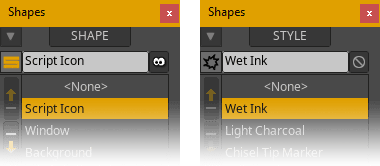
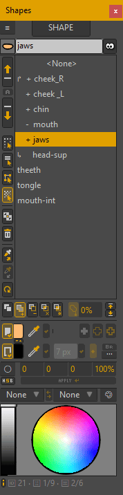
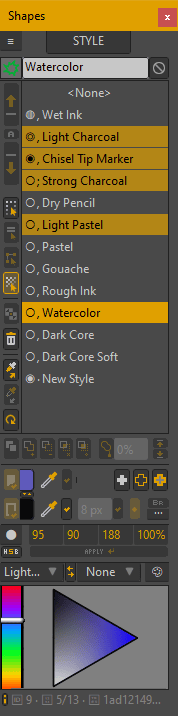
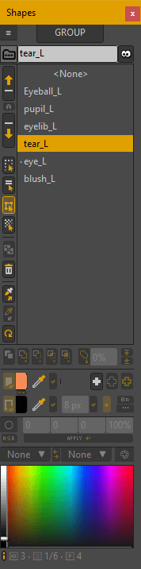
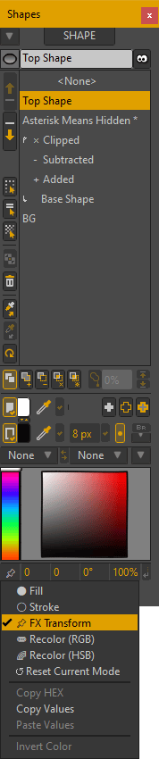
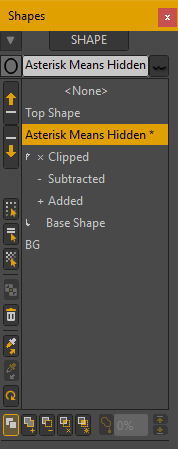

<!--{}-->
<table id='top' width='100%' border='0'>
    <tr>
        <td align='center' valign='middle' width='96'>
            <picture>
                <source media='(prefers-color-scheme: dark)' srcset='./assets/icon_dark.png'>
                <source media='(prefers-color-scheme: light)' srcset='./assets/icon_light.png'>
                
            </picture>
        </td>
        <td align='right' valign='middle' width='916' nowrap>
             
             
             
        </td>
    </tr>
</table>
<!--{}-->

<!-- Pure Markdown style heads...
|  | [![h-1i]][h-1a] [![h-2i]][h-2a] [![h-3i]][h-3a] |
| :----------------------- | ----------------------------------------------: |
-->
<!-- Or a mixture...
<table id="top" width="100%" border="0"><tr><td align="left" valign="middle" width="96">

</td><td align="right" valign="middle" width="1920" nowrap>

[![h-shield1-i]][h-shield1-a] [![h-shield2-i]][h-shield2-a] [![h-shield3-i]][h-shield3-a]
</td></tr></table>
-->
# LS Shapes Window

Paleta persistente de formas con utilidades para una mejor gestión de los vectores de Moho® en general y las *Liquid Shapes* en particular. Este script ofrece una interfaz visual y amigable para realizar sin esfuerzo desde las operaciones con formas más básicas hasta las más complejas, además de modos de ventana dedicados que también llevan la gestión de estilos y grupos de puntos al siguiente nivel.

 

## Galería

<strong>UI</strong> (Expandir/Contraer)  

 

<table align="center" border="0" class="gallery"><tr>
<td width="178" valign="top"><!-- width="1024px" for full width container-->

</td><td width="178" valign="top">

</td><td width="178" valign="top">

</td><td width="178" valign="top">

</td><td width="264" valign="top">

 Swatches")
</td><td width="178" valign="top">

</td>
</tr></table>

<!--

	

		&ensp;&ensp;
	

	 
	<table align="center" border="0" class="gallery">
		<tr>
			<td nowrap data-comment="Use width='1024px' for full width container">
				&ensp;
				&ensp;
				&ensp;
				&ensp;
				&ensp;
				
				 
			</td>
		</tr>
	</table>

-->
 

## Características

- Hazte una idea precisa del contenido de las capas y las relaciones entre formas de un vistazo.
- Sácale el máximo partido a las *Formas Líquidas* de Moho® gracias a una gestión mejorada.
- Renombra, reordena, oculta/muestra, etc. uno o varios elementos con facilidad.
- Nuevas maneras de crear formas (incluso *formas apiladas*) sin importar la herramienta actual.
- Asistentes de selección de formas: Seleccionar todo, Inverso, Similar, Idéntico...
- *Selección basada en puntos* mejorada y sensible al modo.
- Gestión, selección y creación de *Estilos* mejoradas.
- Gestión, reordenación y modificación de *grupos de puntos* mejoradas.
- Muchas paletas/muestras de color interactivas (¡y puedes crear las tuyas fácilmente!).
- Modelo de color HSV y funciones de recoloreado, además de muchas otras utilidades.
- Varios modos de visualización de ventana para adaptarse mejor a tus necesidades.
- Y cómo no... ¡mucho más!

 

## Descarga e instalación

[**Descarga**][h-shield1-a] el archivo, **descomprímelo**, y procede con el método de instalación que prefieras...

| MANUAL (RECOMENDADO)                                                               | ASISTIDA POR MOHO®                                                                     |
| ---------------------------------------------------------------------------------- | -------------------------------------------------------------------------------------- |
| 1. Obtendrás algunas de estas carpetas:  `Menu / ScriptResources / Tool / Utility` | 1. En Moho, ve a "Guiones > Instalar Guiones…" para abrir el asistente de instalación* |
| 2. Ponlas en la carpeta *Scripts* de tu [Carpeta de contenido personalizado][3-1a] | 2. Pulsa *Selecciona una carpeta de Guion*, ve y **selecciona** la que descomprimiste  |
| 3. Reinicia Moho® (o `Alt+Shift+Ctrl + L` para *Recargar Herramientas y Pinceles*) | *  Para más detalles, ve a la sección [23.17 Instalar guion…][3-2a] del manual de Moho |

Y eso es todo! El script debería aparecer en la paleta *Herramientas* y/o dentro del menú *Guiones*.

> ⚠ **ADVERTENCIA:** Por favor, asegúrate de que has desinstalado todo *Lost Script* en tu sistema antes de eliminar cualquier recurso compartido, de lo contrario podrían empezar a dar errores o dejar de funcionar. Para desinstalar un script, simplemente elimina cualquier archivo y carpeta que coincida con su nombre y reinicia Moho® o *Recarga herramientas y pinceles* si es necesario.

 

## Uso

1. **Abrir**: Abre la ventana *Shapes* desde la paleta *Herramientas* de Moho® o mediante su entrada en el menú *Guiones*.
2. **Usar**: Ahora puedes mantenerla abierta permanentemente para visualizar y realizar diversas operaciones relacionadas con los vectores de Moho®.
3. **Personalizar**: Despliega el *Menú Principal* de la ventana (arriba a la izquierda ≡) para acceder a diferentes ajustes y acciones.
4. **Tooltips**: Mantén el cursor sobre los distintos elementos, especialmente con *Beginners Mode* activado, para obtener pistas sobre su funcionalidad.
5. **Ayuda rápida**: También hay un práctico diálogo con abundante información útil accesible desde *Menú principal > Ayuda...*

 

 

## Colab & soporte

Las sugerencias y *bugs* se pueden reportar en la sección [*Issues*](https://github.com/lost-scripts/ls_shapes/issues "Ir a la sección ''Issues''") (preferiblemente) o en el hilo correspondiente, si lo hay, en la sección [*Scripting*](https://www.lostmarble.com/forum/viewforum.php?f=12 "Ir a la sección ''Scripting'' del foro Lost Marble") del [*foro Lost Marble*](https://www.lostmarble.com/forum "Ir al foro Lost Marble").

 

## Agradecimientos

Mi más sincero agradecimiento a...

- **Stanislav Zuliy** (Stan), por todas sus contribuciones y generosidad.
- **Lukas Krepel**, por allanar el camino *modeless* 🙂
- **Mike Kelley**, por permitirme usar las entrañas de su genial script *Adjust Colors*.
- **Wes** (synthsin75), **Paul** (hayasidist) y **Sam** (SimplSam), por su apoyo en los [foros de LM](https://www.lostmarble.com/forum).
- **Copilot** y **ChatGPT**, por... erm... ¿Por qué no? 🤷‍♂️

Y, por supuesto, a **Lost Marble** y al talentoso equipo de Moho® por su arduo trabajo y por hacer todo esto posible (otra vez).

 

## Otros...

- <a href="https://lost-scripts.github.io/scripts/ls_shapes" data-alt-href="https://github.com/lost-scripts/ls_shapes" data-alt-textContent="Repositorio de Shapes window" data-alt-title="Ir al repositorio de Shapes Window...">Página web de Shapes Window</a>
- [Lost Marble Forum topic](https://www.lostmarble.com/forum/viewtopic.php?t=36508 "Go to the Lost Marble Forum topic...")

---

[h-shield1-i]: https://img.shields.io/github/downloads/lost-scripts/ls_shapes/total?logo=&color=blue
[h-shield1-a]: https://github.com/lost-scripts/ls_shapes/releases/latest/download/ls_shapes.zip "Descarga la última versión..."

[h-shield2-i]: https://img.shields.io/github/release/lost-scripts/ls_shapes
[h-shield2-a]: https://github.com/lost-scripts/ls_shapes/releases/latest "Ir al lanzamiento en GitHub..."

[h-shield3-i]: https://img.shields.io/badge/for-Moho_Pro_14.5+_(Win)-orange
[h-shield3-a]: https://moho.lostmarble.com/ "Ir al sito web de Moho..."

[3-1a]: https://manual.lostmarble.com/app/page/1bmBks7y8KPdbPd-ll9kQGPdZJfDf3Rq67BCp8F5Y-FI?p=1UxA8Gi5DttJku9AmFlSpO0gJw4U9flX3
[3-2a]: https://manual.lostmarble.com/app/page/1IOuEOfMa7kUwqYPi2ABDhwoWE_KXB1OBCC5ib__iyIE?p=1UxA8Gi5DttJku9AmFlSpO0gJw4U9flX3
